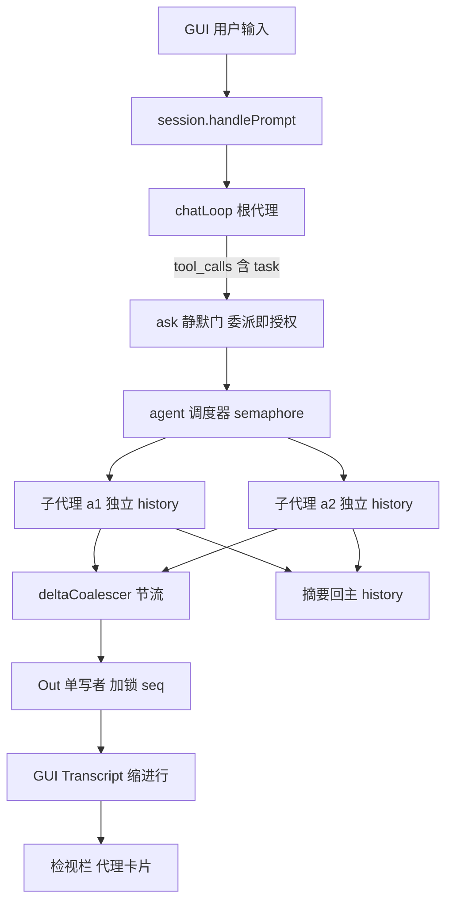

# 子智能体（Subagent）与协议 v5 方案

## 用户需求

在现有 ECDI_fake_harness 上实现子智能体（subagent）能力，直接按「协议 v5 一次做到位」的路线落地：core 支持主代理委派子代理、多个子代理可并行执行、每个子代理拥有独立上下文；协议与 GUI 增加 agent/parent 维度，使子代理的过程、状态与结果在界面上可见。

权限模型已拍板为「委派即授权」：`task` 工具调用过一次权限门，子代理继承该次授权覆盖的只读工具集（read_file / list_dir / grep，限定工作区内），内部不再逐个询问；界面上必须写清本次授权覆盖的任务与工具范围，不得静默扩大权限。

## 产品概述

一个本地 GUI 上运行的编码助手：用户发一句话，主代理可以自己判断「这活该分给谁」，把探查类任务派给一个或多个子代理并行去做，主代理只拿到结论摘要继续推理。界面上，子代理的工作痕迹以缩进形式挂在发起它的那次调用下面，右侧检视栏有一张「代理」卡实时显示每个子代理的名字、状态、轮数与耗时；用户不需要切换会话就能看出「现在是谁在干活、干到哪一步」。

## 核心功能

- 主代理可调用 `task` 工具委派子代理，子代理拥有独立对话历史，其上下文不污染主代理。
- 同一条助手消息里的多个 `task` 调用可并行执行，受并发上限约束；子代理不得再开子代理（深度固定为 1）。
- 委派即授权：一次权限确认覆盖子代理可见的只读工具集与轮数/时间预算，确认文案显式列出授权范围。
- 子代理的思考、工具调用、工具结果以带缩进的行流式出现在主转录中，归属清晰、可折叠。
- 检视栏「代理」卡片列出主代理与全部子代理的实时状态、轮数、耗时，点击可定位到对应块。
- 停止按钮一次取消主代理与全部在跑的子代理；子代理失败只影响自身，主代理照常收尾并说明原因。
- 顶部状态胶囊在并行时显示当前活跃代理数量。
- 子代理的 token 用量单独记账，不计入主代理的上下文占用百分比。

## 技术栈

沿用现有栈，不引入任何新依赖：

- core：Go 1.25 标准库（`core/cmd/ecdi-core/`、`core/internal/wire/`），保持零第三方依赖。
- GUI：C++ / CMake / Ninja，外部消费 ECDI 前缀，自绘控件（`gui/src`）。
- 契约与校验：`protocol/PROTOCOL.md` + `protocol/fixtures/*.jsonl` + `protocol/validate.py`。
- 回归：`tools/regress.py`、`tools/precommit-check.py`。

## 实现方案

### 关键决策与取舍

1. **只加字段，不加 `kind`**。v5 在 `block_start` 上增可选 `agent` / `parent`，新增独立控制消息 `agent`（生命周期），不改七个 kind 的语义。理由：`PROTOCOL.md:390` 的 I8 规定未知 kind 必须中性渲染并记账，新增 kind 会让「未知」与「已知」两条路径混在一起；而可选字段对老读者天然是「忽略并记录」，符合 §9「同一主版本内只增不改」的精神。

2. **`state` 不收编代理维度**。主 `state` 仍只表示根代理，`PROTOCOL.md:422` 的「使能只由 state 驱动」因此逐字保留，GUI 的发送/停止门控零风险。子代理状态走 `agent` 消息，只用于展示。

3. **I3 不放宽，改为「静默门」**。全局仍至多一个未决 `ask`：`Out.Emit` 外层加一把读写锁，普通消息取读锁，`ask → state=waiting → 等 answer` 全程持写锁。这样「ask 后不得再发任何消息」在并发下依然成立，且不需要给 GUI 增加新语义。委派即授权意味着子代理几乎不触发 ask，排队路径只是兜底。

4. **并发安全从写端收口**。`wire.Out` 增互斥锁保护 `seq` 分配与整行写出（`core/internal/wire/out.go:48-51` 当前无锁，是并发下违反 I4 的唯一入口）；块号改成 `atomic.Int64` 并按 `agent` 前缀分空间（`a1-b3`），避免两路自增撞 id。

5. **GUI 用「平铺 + 缩进」而不是「卡片内嵌套」**。`CollapsiblePanel` 的展开体当前只放一个 Label（`AppTranscript.cpp:290-393`），把子行塞进父卡片等于重写折叠体容器；而 `Relayout` 本来就是按 `rows` 顺序做 y 累加（`AppHud.cpp:191-353`），给 `RowRec` 加 `indent` 并把该行内宽减去缩进即可，复杂度不变、O(行数)。

6. **代理可见性放检视栏，不动侧栏会话列表**。子代理不是会话，硬塞进 `m_sessions` 会撞「同时只有一个活动会话」这条硬不变量（`App.h:1180-1191`）；检视栏已有「模型」卡片这种卡片化先例，新建 `AppAgents.cpp` 挂一张「代理」卡，对 `AppUiMain.cpp` 只加一行调用。

7. **默认关闭**。新增 `--agents` 开关，未开启时 `hello.caps` 不含 `"agents"`、`toolDefs()` 不含 `task`、发出的消息逐字节与今天一致——这是本项目「既有路径逐位不变」的纪律，也是回归门能保持绿的前提。

### 协议 v5 增量

- `hello.protocol = 5`；`caps` 增 `"agents"`（仅在 `--agents` 开启时声明）。
- 新消息 `agent`（core→gui，控制面，不是转录块）：

```
{"t":"agent","seq":7,"ts":"...","id":"a1","phase":"start","name":"explorer",
 "parent_call":"b5","depth":1,"task":"定位子代理相关的渲染入口","model":"glm-4.6"}
{"t":"agent","seq":31,"ts":"...","id":"a1","phase":"end","ok":true,
 "summary":"找到 5 处入口","turns":3,"input":8123,"output":940,"elapsedMs":18420}
```

- `block_start` 增可选 `agent`（缺省 = 根代理）与可选 `parent`（值为发起这次委派的 `tool_call` 块 id）。
- `ask` 增可选 `agent`（子代理发起时必填）；`state=waiting` 仍为其伴随消息。
- `usage` 保持只描述根代理；子代理用量只出现在 `agent.phase=end`，避免污染上下文百分比。
- 新增不变量：
- **I12**：`agent` 的 `id` 一份流内唯一；`phase=start` 必须先于任何携带该 `agent` 的 `block_start` / `ask`；`phase=end` 之后不得再出现该 `agent` 的任何块。
- **I13**：带 `agent` 且带 `parent` 的块，其 `parent` 必须指向一个已存在的 `tool_call` 块，且该块属于父代理；根代理的块不得带 `agent`。
- `PROTOCOL.md` §9 版本表登记 v5；§3.3/§3.6/§5/§7 同步；`validate.py` 的 `KNOWN_TYPES` 加 `agent`，`check_stream` 增 I12/I13 检查。

### core 实现

- `agent.go`（新）：`type agent struct { id, name, parentCall string; depth int; history []chatMessage; ... }`，`func (a *agent) run(ctx) (summary string, usage *chatUsage, turns int, err error)`。复用 `llm.Stream` 与 `executeTool`，工具表由 `toolDefsFor(depth)` 给出（`depth >= 1` 时剔除 `task`），工作区根与只读边界完全继承，不提升任何权限。
- `task` 工具在 `runToolCall` 内特判（它需要会话上下文，不能走无状态的 `executeTool`）：先按现有 ask 门发一次权限请求，问句必须列明任务摘要、授权工具集与轮数/时间上限；允许后发射 `agent phase=start`，再启动子代理。
- 并行：同一条助手消息里的多个 `task` 调用用带缓冲的 `semaphore` 并发执行（上限 `--max-subagents`，默认 2），其余调用照旧串行；所有子代理必须在本轮 `chatLoop` 返回前 `Wait` 退出，杜绝向已关管道写入。
- 节流：每个子代理一个 `deltaCoalescer`（累积 1KB 或 60ms 触发一次写，`block_end` 前强制 flush），把 N 路并发流降为接近单流的 GUI 节奏。
- 限额与取消：`--agent-max-turns`（默认 8）、`--agent-timeout`（默认 120s）、深度 1、并发上限；`turnCtx` 派生给全部子代理，`cancel` 一次全停，子代理以「已取消」收尾自己的块。
- 上下文隔离：子代理 `history` 独立，不写主 `contextlog`、不参与 `compressContext`（`session.go:644`）；主 `history` 只追加一条 `tool` 消息（摘要）。

### GUI 实现

- `Transcript.h/.cpp`：`Block` 增 `agentId` / `parentId`；`OnLine` 解析这两个字段；新增 `m_agents`（id → 名称/状态/父调用/轮数/耗时/摘要），`agent` 消息进 `kKnown`，老流无该消息时零影响。
- `AppStream.cpp`：处理 `t == "agent"`，更新代理表与对应卡标题；`delta` 仍按 id 改文本，不改并发模型。
- `AppTranscript.cpp`：`BuildBlockRow` 设置 `rec.indent = 24 * depth` 与 `rec.agentTag`；工具卡标题对 `task` 调用显示「› task · 子代理 a1 运行中 / 完成 · 3 轮」。
- `AppHud.cpp`：`Relayout` 内按行计算 `rowInnerW = innerW - r.indent`，面板 x 起于 `canvasX + r.indent`，并在缩进行左侧画一条 2px 竖线（子代理归属的视觉锚点）。仅动宽度/位置计算，不碰文本测量与换行缓存。
- `AppAgents.cpp`（新）+ `App.h` 声明：`BuildAgentCard(ECDI::Panel&)`、`RebuildAgentList()`、`FocusAgentBlock(id)`（滚动到对应行）；`BuildInspector` 末尾加一行调用。
- `ProbeAgents.cpp`（新）：`--agent-probe` 输出 `indentRows`、各代理状态、卡片字段，并自带负对照（无 agent 的夹具必须 `indentRows == 0`）；接入 `tools/regress.py` 的 `EXTRA_PROBES`。

### 性能与可靠性

- 发射路径：`Out.Emit` 的锁只覆盖「分配 seq + 写一行」，临界区小；静默门的写锁仅在 ask 期间持有，不进入流式热路径。
- GUI 布局：缩进不改变 `Relayout` 的 O(行数) 复杂度；缩进只影响每行宽度输入，宽度稳定后命中既有 wrap 缓存，不会引入逐帧重测。
- 节流后单帧新增行数与今日同量级，`kMaxLinesPerCallback` / `kBudgetUs`（`AppStream.cpp:105-117`）预算不需要调整。
- 失败隔离：子代理 4xx/5xx、超时、预算耗尽都只在自身块上 `ok:false` + 摘要，主代理收到失败文本继续推理，不中断整轮。
- 幂等与清理：`agent phase=end` 与 `block_end` 都由最终状态机单点发出；`turnListener.stop()` 之前必须等全部子代理退出，避免写已关闭的 stdout。

## 架构设计



## 目录结构

```
protocol/
├── PROTOCOL.md                              # [MODIFY] §3 增 agent 消息与 block 可选字段；§5 增 I12/I13；§7 增渲染规格；§9 登记 v5
├── validate.py                              # [MODIFY] KNOWN_TYPES 加 agent；check_stream 增代理生命周期与 parent 校验
└── fixtures/
    ├── subagent/parallel-two-agents.jsonl   # [NEW] 主代理并行派两个子代理、交错 delta、各自收尾的正向夹具
    └── hostile/
        ├── agent-undeclared.jsonl           # [NEW] 块携带未 start 的 agent，必须触发 I12
        ├── agent-after-end.jsonl            # [NEW] agent 结束后仍有块，必须触发 I12
        └── parent-dangling.jsonl            # [NEW] parent 指向不存在的块，必须触发 I13

core/internal/wire/
└── out.go                                   # [MODIFY] Emit 增互斥锁保护 seq 与整行写出；Seq 同锁；保持 burst 刷新语义不变

core/cmd/ecdi-core/
├── main.go                                  # [MODIFY] 新增 --agents / --max-subagents / --agent-max-turns / --agent-timeout；仅开启时 caps 声明 agents
├── session.go                               # [MODIFY] 块号原子化并按代理分空间；emitGate 静默门；runToolCall 特判 task；本轮结束前 Wait 全部子代理
├── tools.go                                 # [MODIFY] toolDefsFor(depth) 按深度裁剪；新增 task 工具定义与参数 schema
├── agent.go                                 # [NEW] 子代理结构、独立 history 的 run 循环、budget、deltaCoalescer、并行 semaphore
├── agent_test.go                            # [NEW] 脚本化 SSE：委派成功、并行交错、取消传播、深度限制、上下文隔离、节流合批
└── session_test.go                          # [MODIFY] 现有用例补 --agents 关闭时的逐字节不变断言

gui/src/
├── Transcript.h                             # [MODIFY] Block 增 agentId/parentId；增 AgentInfo 表与查询接口
├── Transcript.cpp                           # [MODIFY] 解析 agent/parent 字段；处理 agent 生命周期消息；kKnown 增 agent
├── App.h                                    # [MODIFY] RowRec 增 indent/agentTag；Session 增代理表；声明代理卡与定位接口
├── AppStream.cpp                            # [MODIFY] 处理 t==agent；task 卡标题随子代理状态更新
├── AppTranscript.cpp                        # [MODIFY] BuildBlockRow 设置缩进与子代理标签；不改正文断行/表格渲染
├── AppHud.cpp                               # [MODIFY] Relayout 按行扣减缩进并画归属竖线；状态胶囊显示活跃代理数
├── AppAgents.cpp                            # [NEW] 检视栏「代理」卡构建、列表重建、点击定位滚动
├── AppUiMain.cpp                            # [MODIFY] 仅在 BuildInspector 末尾加一行挂载代理卡，不触碰 composer
├── ProbeAgents.cpp                          # [NEW] --agent-probe：缩进行数、代理状态、负对照
└── AppSummary.cpp                           # [MODIFY] 摘要增 agents/agentBlocks/indentRows 计数

tools/regress.py                             # [MODIFY] EXTRA_PROBES 增 --agent-probe 及判据（含无 agent 夹具的负对照）
README.md                                    # [MODIFY] 增 --agents 运行方式与 v5 说明；docs/P3-real-core-spec.md 回写委派与权限决策
```

## 执行注意

- 另一条并行会话正在改「输入框多行」与「markdown 表格管道」，落点集中在 `AppUiMain.cpp` 的 composer 与 `AppTranscript.cpp` 的正文渲染。本方案对 `AppUiMain.cpp` 只允许增加一行代理卡挂载；`AppTranscript.cpp` 只允许改块行构建与行内宽，禁止顺手重构断行/表格代码。
- 新增路径全部由 `--agents` 开关控制；关闭时 `hello.caps`、`toolDefs()`、块的字段集必须与今日逐字节一致，否则既有 25 个探针与 6 份夹具基线的读数会漂。
- 任何对 ECDI 框架的修改都不在本仓库进行；若缩进渲染撞上 ECDI 能力缺口，先登记需求并给受控对照，不在本阶段顺手改框架。
- 改完必须 `python protocol/validate.py` 与 `python tools/regress.py` 双绿；hostile 夹具「什么都没触发」按失败处理。

## Agent Extensions

### SubAgent

- **code-explorer**
- Purpose: 在动手前枚举 `Relayout` 内宽的全部消费点、`Block` 字段的读取方、`kKnown` 与探针的依赖链，确认缩进改动不会波及正文断行与表格渲染路径。
- Expected outcome: 一份带文件与行号的改动面清单，明确哪些调用点必须同步、哪些必须避开，从而保证与并行会话的改动不冲突。

## 落地记录（2026-11-04）

| 批 | 范围 | 状态 |
|---|---|---|
| B1 | 协议 v5：`PROTOCOL.md`（§3.1 caps / §3.3 可选 agent+parent / §3.12 / I12+I13 / §7 渲染 / §9 版本表）、`validate.py`、1 正向 + 3 hostile 夹具、`kProtocolMaxSupported` 4→5 | ✅ 已提交 `e64e7f4` |
| B2 | core：`agent.go`、`task` 特判、semaphore、`out.go` 加锁、6 条 `agent_test.go` | ✅ 已提交 `2675585` |
| B3 | gui：`Block` 归属字段、`agent` 消息吸收、缩进行 + 归属竖线、`AppAgents.cpp`（代理卡 + 点击定位）、胶囊活跃数、`--agent-probe` + 负对照 | ✅ 本批 |
| B4 | `regress.py` 接线 + 全量回归 + README/规格回写 | ⏳ |

### 实现与本文的四处偏离（都为了同一个理由：别把不可见的东西当已实现）

1. **I3 的保法：改「相序」而不是「Emit 加静默门写锁」。** 全部 ask 在任何子代理启动之前跑完，
   「ask 期间有子代理在吐流」这个组合因此不存在。理由：写锁会让**用户的思考时间 = 整条转录冻结**，
   且死锁面更大。代价：同一条消息里 `task` 与非 `task` 混用时执行顺序被重排（先非 task，再并发 task）。
2. **delta 合批只对子代理开**。根代理的 delta 粒度是既有探针读数的基线，动它等于改基线。
3. **顶栏状态胶囊 60px → 104px**。并行时文本形如「思考中… 2代理」，60px 会把「代理」裁掉，
   而裁掉的恰好是唯一的新信息。加宽量由顶栏中段 stretch 吸收。
4. **`--agent-probe` 多了第 ⑤ 条判据（本文原文只有四条）**：`cardRows == agents + 1`（含主代理行）
   且 `cardVisible == (agents > 0)`。理由：代理卡是本轮**全新 UI**，四条缩进判据**照不到它**——
   卡片错建（空卡 / 永远隐藏 / 漏主代理行）时缩进读数依然全绿，屏幕上依然有缩进行。这属于
   `LESSONS.md` 里「跑过 ≠ 判过」那一族的直接应用。

### 视觉复核（截图 + 像素读数）抓到的两件事

这两条**探针都读不出来**，只能靠看图 + 读像素发现——按本仓纪律记在这里，别当成"已完成"：

1. **代理卡加在 `BuildInspector` 末尾会被窗口下边界截断**（1920×960 实测：只剩「代理」标题与
   「主代理 · 思考中」一行露头，两个子代理行全在视野外）。检视栏是固定列高的 `VerticalLayout`、
   **不滚动**，第 7 张卡必然溢出。⇒ 已上移到「用量」卡之后。代价：开发者模式下被挤下去的是
   末尾的「协议健康」「权限历史」（用户模式这两张默认隐藏，一屏放得下）。
   ★ 探针 `cardRows`/`cardVisible` 对此**完全无感**：卡建好了、行数对、`visible=true`，
   只是画在窗口外面。这正是"跑过 ≠ 判过"的又一例。

2. **归属竖线是逐行分段（行距 10px 处断开）**，不是一条连续轨道。试过"下一行同属该代理时
   高度补上 `kRowGap`"，**零效果**——像素读数仍是「段长 36、间隔 10」。根因是 ECDI 的
   `Widget::Paint` 管线为**每个控件**发 `PushClip`（`ECDI/src/Widget/Panel.cpp:45` 注释明写），
   子控件超出父矩形的部分一律不可见。⇒ 已把那段死代码撤掉，并在 `Relayout` 里写明原因。
   **待办**：要连续轨道必须把竖线提到画布层（作为内容容器的子控件按绝对 y 摆放），
   那要改 `CreateBlockRow` 与 `Relayout` 的"不改树结构"纪律，另开一批做。

### 当前未做

- `--agents` 默认**关**（`main.go`）。GUI 尚未把该开关写进 `coreArgs`，故从应用里点不出子代理；
  B4 收口时连同设置面板开关一起处理（见 `TODO`）。
- 代理卡的「点击定位」只做**滚动到该代理首行**，不做高亮闪烁。
